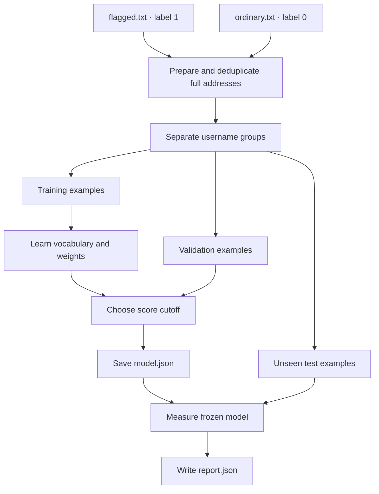
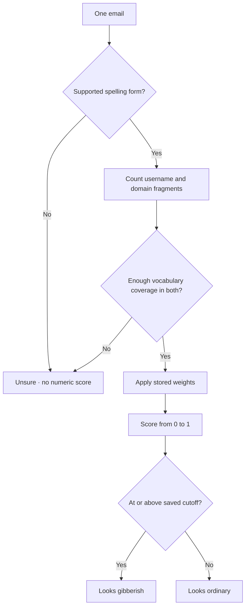

# How an email address becomes a score

## Start with two functions

Imagine writing `looks_generated(email)`. You could manually decide how much to penalize every sequence of letters. In this project you write a different program. You specify how to **describe** an address using numbers. You give a learning algorithm example addresses and the answers you want. The algorithm finds a set of weights for those numbers. That fitted scoring function is the **model**.

| Function | Inputs | Output | When it runs |
|---|---|---|---|
| `train` | Flagged addresses and ordinary addresses with answers already supplied | A saved set of weights, a chosen cutoff, and an evaluation report | When you build a new version |
| `predict` | One new address and the saved weights | A score and decision, or a reason for being unsure | Whenever somebody checks an address |

Training changes the model. Scoring reads it. You can predict on a laptop that has never seen the original training lists, provided it has the scorer, matching preprocessor and suffix data, and `model.json`.

### The software setup words

| Term | Plain meaning |
|---|---|
| Python | The interpreter that runs the instructions in the `.py` files. |
| `venv` or `.venv/` | A private environment for Python packages in a project directory. `python3 -m venv .venv` creates it. `source .venv/bin/activate` changes the current Terminal's search path so `python` and `pip` use it. Deleting the environment removes its packages. Saved weights in `runs/` remain on disk. |
| `pip` | Python's package installer. Here it installs scikit-learn and dependencies needed during fitting. |
| `dist/` and `.whl` | In the earlier starter, `dist/` held a prebuilt distribution. A wheel is a ZIP-format Python installation package carrying application code, data, and installation metadata. Pip can install a wheel. Packaging and fitting are different operations. This edition runs directly from the included source files. |
| `lexical/model.go` | The earlier starter used this Go source file to load saved weights and calculate scores inside a Go process. “Lexical” refers to spelling and characters. This standalone edition provides that calculation in `engine.py`. |
| Email signal | A name for the information returned to a caller. In this detector the core fields are the numeric score, the decision, model name, and any reason for being unsure. |
| JSON | A readable format for writing data to disk. The three output JSON files have different jobs: learned parameters, measured performance, and repeatable example results. |

## Follow training from input to output



1. **Give each complete address an answer.** Putting an email in `flagged.txt` assigns label `1` and putting it in `ordinary.txt` assigns `0`. The task is to learn resemblance to addresses flagged for **gibberish spelling**. If a flagged batch was selected because of unusual payments or mailing volume, those labels answer a different question. Review the reason for your positives before training.
2. **Prepare the spelling.** For `RAVI@mail.vendor.co.in`, the supported-ASCII feature copy contains username `ravi` and registrable domain label `vendor`. The suffix lookup recognizes `co.in`. The subdomain `mail` and the suffix do not become spelling features. Dots, plus tags, and digits within the username are preserved. Email identity and mail delivery do not use this feature copy.
3. **Remove duplicates and label conflicts.** Identical model inputs count once. For example, `ravi@vendor.com` and `RAVI@mail.vendor.co.in` have identical model inputs in this version. If the two lists disagree on one such input, the trainer reports the two source lines so you can resolve them.
4. **Set aside examples for separate jobs.** A deterministic, class-stratified split uses five groups of rows, approximately equal in size. Three folds supply training, one supplies validation, and one supplies final testing. Addresses with the same username stem before a plus tag stay together across providers. The score still sees the plus tag. This reduces easy leakage. A separate later evaluation should also hold out related campaigns or generators when you know those relationships.
5. **Turn each spelling into a numeric vector.** Collect overlapping fragments 2, 3 and 4 characters long within each component. Record counts under distinct names such as `user:ra` and `domain:ra`. The vocabulary is learned using training rows only. The default retains features that occur in at least two training addresses, up to 50,000 features.
6. **Learn weights with scikit-learn.** Scikit-learn is a Python library providing numerical implementations of machine-learning algorithms. The vectorizer calculates feature values. Its logistic regression implementation fits weights by minimizing prediction error across the training rows. In this version `class_weight="balanced"` gives the two classes equal aggregate weight during fitting. An L2 penalty discourages large coefficients that are insufficiently supported. `C=1.0` sets the regularization trade-off.
7. **Choose a cutoff using validation labels.** Rank the scorable validation examples by score. Among cutoffs that keep the empirical false-flag rate on ordinary validation examples at or below `--max-fpr` (default 5%), choose one that catches the most flagged examples. Ties favor fewer false flags. If none can catch even one within budget, save a null cutoff and return `score_only` on scorable inputs until you choose a policy. A small validation set cannot establish a production false-alert guarantee.
8. **Test once on the reserved examples.** Use the frozen weights and cutoff. Save the counts and metrics in `report.json`. Save a handful of fixed, invented reference examples in `golden.json`. Their numeric reference scores come from scikit-learn. Neither the report nor the golden file is required to calculate a new prediction.

### What makes this actual learning?

Suppose a training row is labeled `1` and the current weights produce `0.20`. The logistic loss for this positive row is `-ln(0.20) ≈ 1.61`. Weights that give the same row `0.80` instead yield a smaller loss of about `0.22`. Ordinary examples supply the complementary pressure. The optimizer fits **all** the weights together to reduce the weighted loss plus the regularization penalty. No one hand-coded that the string `qz` should add a particular number of points. That number came from fitting.

### What is inside model.json?

In this implementation a model file is readable JSON. It stores the model name, schema and preprocessor versions, the intercept, a vocabulary mapping every learned feature to `[idf, weight]`, the minimum coverage needed, and the operating threshold. The weights and IDFs come from training. Coverage is an explicit setting. The cutoff is selected on validation data.

For example, in the bundled model, `user:ra` has IDF approximately `3.367124` and learned coefficient approximately `-0.537028`. The number of occurrences and the other features of the specific address determine how much this entry contributes to that address's score. The model file contains short learned spelling fragments. Treat vocabularies trained on real addresses as controlled data.

## Follow a prediction



The diagram assumes a saved numeric cutoff. `score_only` is the extra policy outcome when validation could not supply one.

### Run the calculation for ravi@gmail.com

```bash
python3 detector.py explain 'ravi@gmail.com' --all
```

**Step A. Preprocess.** The inputs are `ravi` and `gmail`. **Step B. Make n-grams.** An n-gram is a consecutive substring of length n. For `ravi` the bigrams are `ra`, `av`, `vi`, the trigrams are `rav` and `avi`, and the four-character fragment is `ravi`. The domain yields nine fragments, including `gm`, `mai`, and `mail`.

**Step C. Measure coverage.** The training vocabulary contains `user:ra`, `user:av`, and `user:vi`. The other three username fragments were absent or did not meet the vocabulary inclusion rule. Username coverage is `3 / 6 = 50%`. Domain coverage is `9 / 9 = 100%`. Each clears the demo's 20% minimum. Coverage counts fragment occurrences, including repeats. It measures familiarity of the representation. The learned weights determine the direction of the score.

**Step D. Convert counts to TF-IDF values.** TF stands for term frequency, the number of times a recognized fragment occurs in this address. IDF stands for inverse document frequency, a number that reflects how widely the fragment appeared across training addresses. If there are `N` training addresses and `df` of them contain that fragment, the smoothed IDF is `1 + ln((1 + N)/(1 + df))`. Multiply count by IDF, then divide each value by the Euclidean length of the full known-feature vector. This gives you the input value for each weight. For example, `user:ra` has a normalized input of `0.291522` here.

**Step E. Add the learned contributions.** The normalized value for `user:ra` multiplied by its coefficient `-0.537028` contributes `-0.156555`. Repeating the calculation for all known features gives this actual summary, with rounded values.

| Quantity | Contribution |
|---|---:|
| Starting weight, called the intercept | +0.434979 |
| Sum across username features | −0.259001 |
| Sum across domain features | −0.643365 |
| Total, called the margin | −0.467387 |

**Step F. Convert the margin to a score.** Apply `score = 1 / (1 + exp(-margin))`. This S-shaped function is called the sigmoid. Here the score is `0.385235`. The saved cutoff is `0.491688`, so the output label is `looks_ordinary`.

For `qzxv8801@gmail.com`, the username contributes `+1.145849`, the domain contributes `−0.488835` and the score is `0.748757`. The domain contribution can differ even though the host matches because the model normalizes the **combined** vector. On this example, changing the cutoff to `0.80` changes only the returned label. The underlying score remains `0.748757`.

### Three words with different meanings

| Word | Question it answers | Example |
|---|---|---|
| Fragment coverage | How much of each component can this vocabulary represent? | `3 / 6` recognized username fragments |
| Score | Given enough coverage, how strongly do the learned weights favor the flagged label? | `0.748757` |
| Decision threshold | How high must the score be for this application to raise a flag? | `score >= 0.491688` in this demo |

To **abstain** means to return `unsure` and a null score. Try `python3 detector.py explain '||||||||@gmail.com'`. The username has 18 fragment occurrences and the vocabulary recognizes zero. A familiar provider cannot establish how the unseen username should be scored. Other abstention reasons include unsupported input forms, username or domain label shorter than three characters, private relay hosts recognized by the bundled policy, and unrecognized public suffixes. Every scorable input gets a continuous score. Its numerical interpretation is relative to the training task and population. Probability claims require calibration on representative data.

## Read the evidence from the demonstration

The fixture contains 240 invented ordinary and 240 invented flagged addresses. Ordinary examples combine plausible names, roles, aliases and numbers. Of the 240 invented flagged examples, 132 have generated-looking usernames on ordinary hosts, 84 combine ordinary-looking usernames with generated-looking domain labels, and 24 combine both. These are illustrative constructions. No contact with any mailbox occurred.

| Stage | Full addresses used | Purpose |
|---|---:|---|
| Training | 287 (144 flagged, 143 ordinary) | Learn 1,439 feature weights plus an intercept |
| Validation | 97 | Select the cutoff at the configured false-alert budget |
| Final test | 96 | Measure the frozen demo model |

On the final 96, 48 were labeled flagged and 48 ordinary. The model caught 32 of the 48 flagged examples and falsely flagged one ordinary example. It issued a score for 84 of the 96 and abstained on 12. The test data has the same invented provenance as the training fixture. The results demonstrate the workflow. Your performance estimate must come from your reviewed population.

| Report term | Meaning |
|---|---|
| Precision | Of the addresses the detector flagged, what fraction were labeled flagged? Here `32 / 33`. |
| Recall | Of all labeled flagged examples, what fraction did it catch? Here `32 / 48`. An abstained positive counts as missed. |
| Ordinary false-flag rate | Of all labeled ordinary examples, what fraction did it flag? Here `1 / 48`. |
| Report coverage | Fraction of addresses that received a score. Here `84 / 96`. This is distinct from n-gram coverage within one address. |

Training reports show rows excluded at ingestion separately. Their split metrics apply to eligible rows, counting low-coverage abstentions within those splits. The standalone `evaluate` command includes unique out-of-scope inputs in the abstention and end-to-end recall denominators.

## What a sellable detector would have to establish

The observable target here is resemblance to the reviewed positive class. Email text alone cannot establish the creator's intent. For a product, agree on a written labeling rubric, audit false alerts on legitimate names, aliases and corporate IDs, and measure held-out traffic from different sources. Choose a cutoff using the false-alert rate your users can tolerate. A balanced teaching dataset does not represent the rate of gibberish addresses in deployment. Publish the supported formats and abstention behavior with any quality claim.

The demo model is reproducible with the two example files, training defaults, and `--name demo-invented-v1`. Any distribution of the suffix data should retain its accompanying notice. Decide separately what real training data and weights your organization can distribute.

## Authoritative references

- [Python virtual environments](https://docs.python.org/3/library/venv.html)
- [Python package formats and wheels](https://packaging.python.org/en/latest/discussions/package-formats/)
- [scikit-learn text feature extraction](https://scikit-learn.org/stable/modules/feature_extraction.html)
- [Logistic regression](https://scikit-learn.org/stable/modules/generated/sklearn.linear_model.LogisticRegression.html)
- [Stratified group splitting](https://scikit-learn.org/stable/modules/generated/sklearn.model_selection.StratifiedGroupKFold.html)
- [Probability calibration](https://scikit-learn.org/stable/modules/calibration.html)
- [Public Suffix List](https://publicsuffix.org/)
