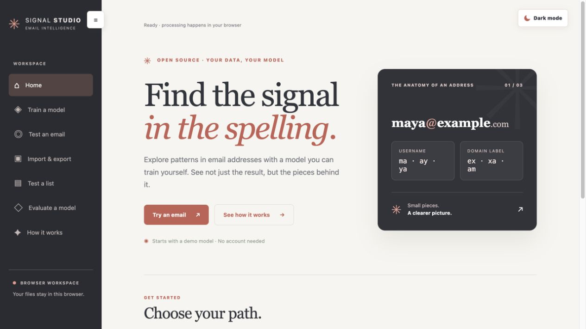
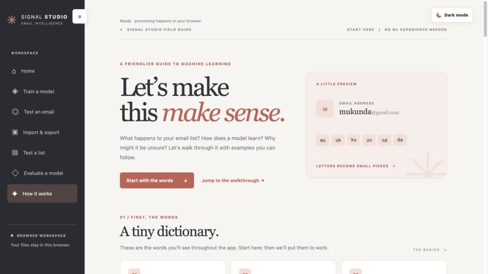
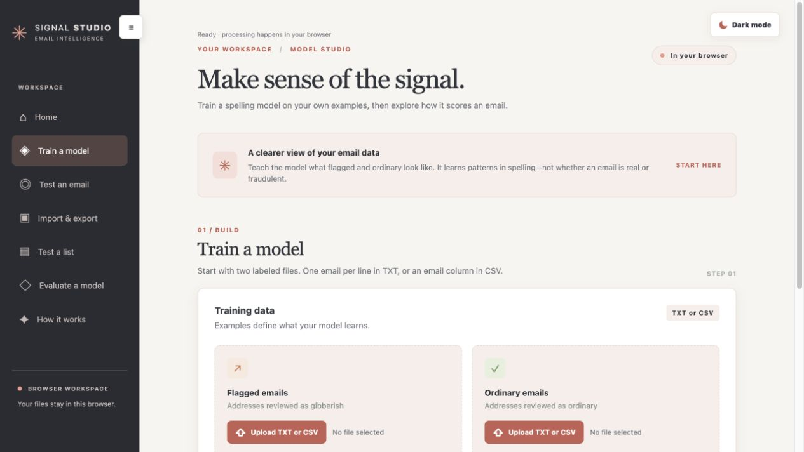
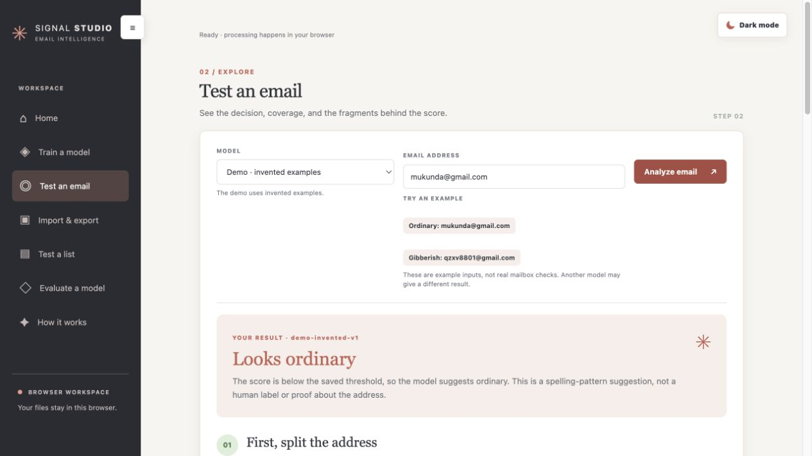
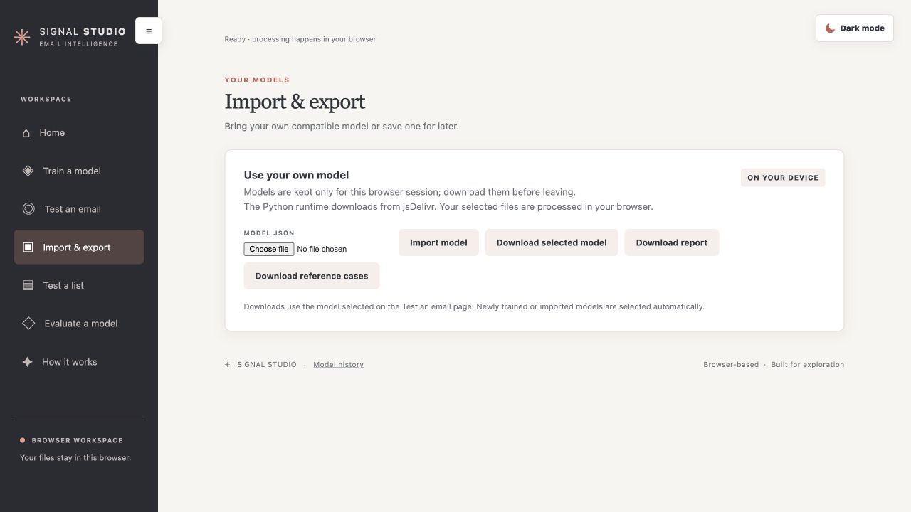
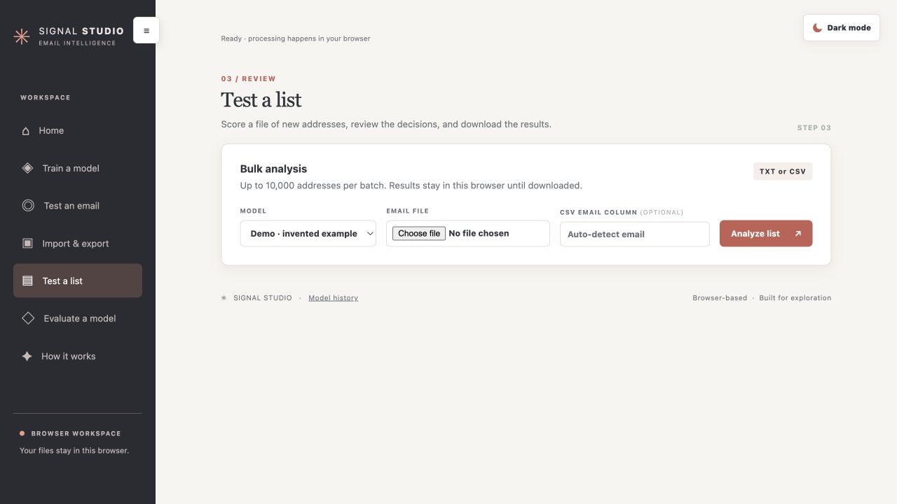
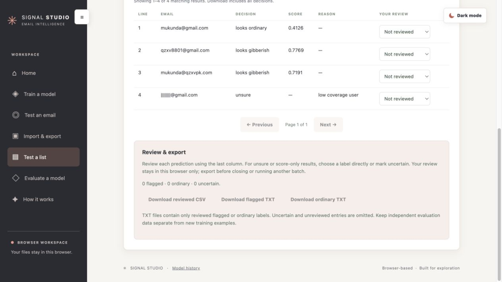
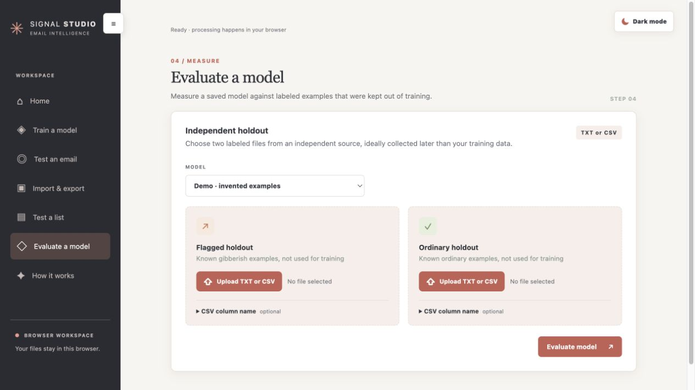
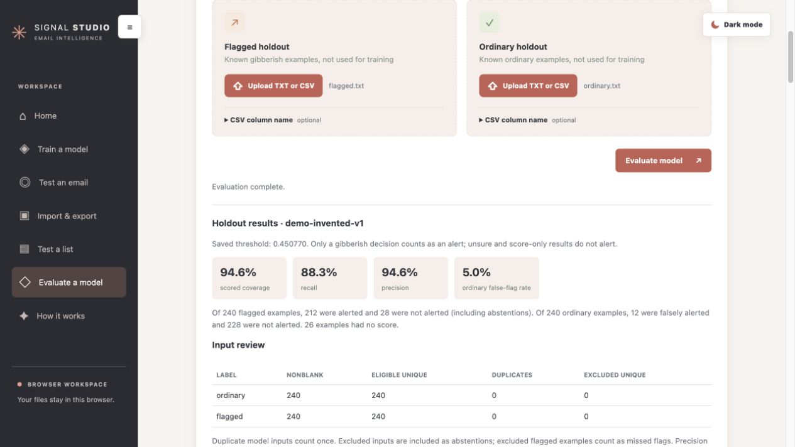

# Standalone gibberish email detector

Give the trainer two labeled TXT or CSV files. One contains full email addresses your reviewers flagged for gibberish spelling. The other contains ordinary full email addresses. It learns one scoring model from the labels. The saved model can score a new bare email address or a whole file. The included demo was trained on invented examples. No real customer lists were supplied.

If machine learning is new to you, start with [How it works](HOW_IT_WORKS.md). It follows one email all the way from characters to a numeric score and includes training and prediction flow diagrams.

## Try the browser app

Open [Signal Studio](https://gibberish-email-detector.mukundaholla.workers.dev/) to try the demo, train with your own labeled files, test addresses, and explore the guide. No account is needed. The app downloads its Python runtime and training dependencies from jsDelivr; selected files and training run in the browser. Internet access is needed to load the app and dependencies.



The sidebar has one page per feature. Use the menu button to collapse it and **Dark mode** / **Light mode** to switch themes; the browser remembers the theme choice. Models trained or imported in the browser last only for the current session. Download them before reloading or closing the page.


## Get started with the local interface

You need Python 3.11 or newer. Python 3.12 is the tested version. From a Terminal opened in the project directory, create an environment, install the training dependency, and start the app:

```bash
python3.12 -m venv .venv
source .venv/bin/activate
python -m pip install -r requirements.txt
python local_ui.py
```

Open [http://127.0.0.1:8765](http://127.0.0.1:8765). Keep Terminal open while using the app; press **Ctrl-C** there to stop it. Next time, navigate back to the project directory and run `source .venv/bin/activate` followed by `python local_ui.py`. Use your Python executable in place of `python3.12` if it has a different name.

The server listens on your computer only. Training requires the installed dependency; the demo can be scored with the Python standard library. The demo model uses invented examples and is for learning the workflow, not for judging real-world performance.

## How to use the interface

Use the sidebar to open **Home**, **Train a model**, **Test an email**, **Import & export** (browser edition), **Test a list**, **Evaluate a model**, or **How it works**. Each feature has its own view; switching views keeps the current session. **Model history** is linked in the footer. The screenshots below show the hosted browser edition; local storage and training behavior differ as described below.

### Explore the learning guide

Open **How it works** for a plain-English glossary and interactive training and detection walkthroughs. The training walkthrough shows how labeled examples become a model; the detection walkthrough follows the demo score for `mukunda@gmail.com`. The results lesson uses six fictional addresses to explain precision, recall, false alerts, and scored coverage. The guide distinguishes fragment coverage and scored coverage from code coverage.



### 1. Prepare your labeled files

Create two UTF-8 files: **flagged** addresses reviewed for gibberish spelling and **ordinary** addresses. The label describes spelling, not whether a mailbox works or a person is fraudulent. Keep uncertain examples out of both files.

- **TXT:** Put one complete email address on each line, with no header. Blank lines are ignored.
- **CSV:** Include a header row. A column named `email`, `email address`, or `email_address` is detected automatically. Otherwise, expand **CSV column name (optional)** and enter the exact column header, such as `contact_email`. This field is for a column name, not pasted addresses; it is unnecessary for TXT files.
- Keep independent holdout data aside before training. Use many reviewed examples; the code's minimum of five eligible username groups per class is only a mechanical requirement.

For a practice run, use the invented files [examples/flagged.txt](examples/flagged.txt) and [examples/ordinary.txt](examples/ordinary.txt).

### 2. Review the data and train



1. Under **Train a model**, use **Upload TXT or CSV** to choose each file. The filename appears beside the button. For a CSV with a nonstandard email-column name, expand **CSV column name (optional)** and enter the exact header.
2. Click **Preview data** to see duplicates, contradictory labels, and unsupported addresses. Select rows and click **Exclude selected & review again** to leave them out of this run; your original files are not changed. Replacing a file or changing a CSV column resets these exclusions.
3. Optionally enter a model name and expand **Training settings**. The defaults are a minimum fragment frequency of 2, minimum component coverage of 20%, and validation false-alert budget of 5%. The budget is a target measured on the validation data, not a future guarantee.
4. Click **Train model**. The status shows the current stage, and only one UI training run can run at a time. In the browser edition, keep the page open until training finishes and download the model before leaving. In the local edition, refreshing loses the progress view but training can continue while the server runs; stopping the server interrupts it.
5. Review the saved model's test metrics. The newly trained model is selected for testing, bulk analysis, and evaluation. Use fresh, independent data for a further performance check.

### 3. Test one email



1. Under **Test an email**, select the demo or one of your saved models.
2. Enter a complete address or select one of the example buttons, then click **Analyze email**.
3. Follow the result from the username/domain split through known and unknown fragments, coverage, the score calculation, and the saved threshold. Expand **See the strongest individual fragment effects** for more detail. Positive effects push toward flagged; negative effects push toward ordinary. Low coverage can lead to **unsure** without a score.

`looks_gibberish` and `looks_ordinary` are model decisions, not proof of fraud or deliverability. `unsure` means the model declined to score; inspect the reason. `score_only` means it could calculate a score but has no saved cutoff.

### Import and export a model (browser edition)



Open **Import & export** to load a compatible `model.json` (up to 10 MiB). Imported and newly trained models are selected automatically. To save a model for another session, select it on **Test an email**, return to **Import & export**, and download the model. You can also download its report and reference cases when available. An imported model does not automatically include those other files.

### 4. Test and review a list



1. Under **Test a list**, select a model and upload an unlabeled TXT or CSV file. For CSV, specify the email column if it isn't detected. Try [examples/incoming.txt](examples/incoming.txt) with the demo.
2. Click **Analyze list**. The summary counts decisions; use **Show** and the page controls to inspect results. The interface accepts up to 10,000 addresses per batch; the CLI's `batch` command is available for larger TXT lists.
3. Click **Download all results · CSV** to save the full list with line numbers, scores, decisions, model, threshold, coverage, and reasons. The download includes all decisions even when a filter is active. Cells that could be interpreted as spreadsheet formulas are prefixed with an apostrophe.



To build a reviewed dataset, mark binary decisions **Correct**, **Incorrect**, or **Uncertain** in the last column. For `unsure` or `score_only`, assign a label directly or choose **Uncertain**. Download the reviewed CSV for an audit trail and the separate flagged and ordinary TXT files for a future training run. Uncertain and unreviewed rows are omitted from the TXT files; addresses containing newlines remain in the CSV only. Reviews live in the browser until exported and are cleared when you start a new batch or close the page.

### 5. Evaluate on independent data



1. Set aside separate, labeled flagged and ordinary files that were not used to train or select the model, preferably collected later and from an independent source.
2. Under **Evaluate a model**, select the model, choose the holdout files, and click **Evaluate model**.
3. Inspect coverage, recall, precision, false-alert rate, and the input review. Out-of-scope positives and other unscored positives count as missed flags. Group breakdowns use the saved threshold; small groups can give misleading rates, and a registrable domain label is not necessarily a unique provider.
4. Move **Explore a cutoff** to see hypothetical alert and miss counts. The slider does not modify the saved model or the group breakdowns. If you use this dataset to choose a cutoff, measure the chosen cutoff on a different independent holdout before relying on the result.



The screenshots use the invented demonstration files to show the workflow. Those files were used to build the demo model and **are not an independent holdout**; the shown results are not a performance estimate. Also, precision depends on the dataset's class balance; naturally sampled data helps estimate real alert volumes.

### 6. Compare saved models

Open **Model history** from the footer and select **Use model** to select a saved model across the testing and evaluation sections. Choose two models under **Compare two models** to inspect their reported settings and test metrics. The displayed date is the model file's last-modified time, not a guaranteed training date. Results from different test sets aren't directly comparable; evaluate both models on the same independent holdout for a fairer comparison.

### Where data is saved

- **Browser edition:** Selected files are processed in the browser. Trained and imported models, and batch review choices, last for the current session. Download models, reports, and review results before refreshing or closing the page. The app does not provide a shared server-side model database.
- **Local edition:** Trained models are saved in `runs/<model-id>/` as `model.json`, `report.json`, and `golden.json`. The demo is in `demo/`. Original input files stay where you put them; temporary copies are removed after the operation. Local batch review choices remain in the browser until exported.
- Downloads go to your browser's download location. Models and results may contain sensitive addresses or learned fragments; keep private data out of public repositories. The local server is designed for use on your own computer, not as a public multi-user service.

## Command-line usage

The CLI supports the same model format and remains useful for scripting. Scoring uses only the standard library; training requires the environment installed above. The CLI's list commands take UTF-8 TXT files with one complete address per line.

### Try the demo from Terminal


Extract the ZIP. Open Terminal, type `cd `, drag the extracted `gibberish-email-detector` folder into Terminal, and press Return. Run `python3 --version`. Use Python 3.11 or later. Python 3.12 is the tested version. If you have Homebrew and need Python, `brew install python@3.12` installs it. In that case use `python3.12` wherever these commands say `python3`.

```bash
python3 detector.py explain 'mukunda@gmail.com'
python3 detector.py explain 'qzxv8801@gmail.com'
```

The demo scores are about `0.4126` and `0.7769`. Its saved cutoff is about `0.4508`. The first address falls below the cutoff. The second crosses it. For a short JSON result, use `score` instead of `explain`. These commands use Python's standard library and the included weights. Nothing is fitted, downloaded, or sent when you score.

```bash
python3 detector.py score 'mukunda@qzxvpk.com'
python3 detector.py explain 'qzxv8801@gmail.com' --all
python3 detector.py score 'qzxv8801@gmail.com' --threshold 0.80
python3 detector.py self-test
```

The threshold experiment leaves the score unchanged. The self-test should print `PASS — 10 reference cases for demo-invented-v1.`

### Train on your own two files

1. Make a folder named `my-data` in the extracted project. Put `flagged.txt` and `ordinary.txt` in it. Use UTF-8 plain text, exactly one complete address per line, with no headings or bullets. Blank lines are ignored. See `examples/flagged.txt` and `examples/ordinary.txt` for the format.
2. Check what the labels mean. For a lexical detector, place addresses in `flagged.txt` when their **spelling** matches your agreed definition of gibberish. An email flagged solely for a chargeback, a disposable provider, a bulk order, or another business reason needs separate review. Keep unresolved examples out of both lists. An unfamiliar name alone is weak evidence.
3. Create a Python environment and install the training software once.

```bash
python3 -m venv .venv
source .venv/bin/activate
python -m pip install -r requirements.txt
```

4. Train a new model, then tell the scorer which model to use.

```bash
python detector.py train \
  --flagged my-data/flagged.txt \
  --ordinary my-data/ordinary.txt \
  --out runs/my-first-model

python detector.py score 'mukunda@gmail.com' --model runs/my-first-model
python detector.py explain 'mukunda@gmail.com' --model runs/my-first-model
python detector.py self-test --model runs/my-first-model
```

The output directory contains `model.json`, `report.json`, and `golden.json`. A score without `--model` deliberately uses the bundled demo. Training again uses a fresh output directory, for example `runs/second-model`. Updating a text file affects scores only after you train and select the new model.

To practice with the supplied **labeled** data before preparing yours, run the same command with `--flagged examples/flagged.txt --ordinary examples/ordinary.txt --out runs/practice`. In a new Terminal session, navigate back to the project and use `source .venv/bin/activate` again to access the installed training dependency.

### Score a bulk list or test real outcomes

Score new, unlabeled inputs with `batch`. Replace `examples/incoming.txt` with your file.

```bash
python detector.py batch examples/incoming.txt \
  --model runs/my-first-model --out results/predictions.jsonl
```

The output contains one JSON object per nonblank line with the input line number, original email, score, decision, model name, threshold, coverage, and reason. It contains address data and stays on your machine. Use a fresh output filename.

For quality measurement, use emails whose labels you know and which you set aside before development, preferably collected later and from an independent source.

```bash
python detector.py evaluate \
  --flagged holdout/flagged.txt --ordinary holdout/ordinary.txt \
  --model runs/my-first-model
```

Provide the two `holdout/` files yourself. The evaluator counts unique model inputs, rejects contradictory labels, and counts out-of-scope positives as missed flags. Score-only or unsure decisions do not raise an alert. Record prevalence and volumes from naturally sampled data to translate these metrics into expected daily false alerts.

For Python integration from the project directory, load once and call the same function used by the CLI.

```python
from engine import load_model, predict

model = load_model("runs/my-first-model")
answer = predict("mukunda@gmail.com", model)
print(answer["score"], answer["decision"])
```

## Project map

| File or directory | What it does |
|---|---|
| `detector.py` | The entry point. Implements `score`, `explain`, `batch`, `train`, `evaluate`, and `self-test`. |
| `engine.py` | Shared spelling preparation, feature counting, coverage checks, scoring arithmetic, and label decision. |
| `training.py` | Reads both labeled lists, separates training/validation/test groups, calls scikit-learn, chooses a cutoff, checks the export, and writes results. |
| `local_ui.py`, `ui/` | The local web server and interface for training, testing, review, evaluation, and model history. |
| `requirements.txt` | Pins the direct training dependency to scikit-learn 1.8.0. |
| `assets/public_suffix_list.dat` | An offline domain-suffix reference used to identify the registrable label, including multi-part suffixes such as `co.in`. |
| `assets/PUBLIC_SUFFIX_LICENSE.md` | Source revision and license notice for that third-party dataset. |
| `examples/ordinary.txt`, `examples/flagged.txt` | All 480 invented, labeled full addresses used to build the bundled demonstration. |
| `examples/incoming.txt` | Four sample inputs for scoring a batch. |
| `demo/model.json` | The learned demo weights and associated scoring settings. |
| `demo/report.json` | Counts and evaluation results from training the demo. This is the file to read when assessing quality. |
| `demo/golden.json` | Ten fixed invented inputs and their expected outputs for repeatability. |
| `test_browser_backend.py`, `test_detector.py`, `test_local_ui.py`, `test_review.js` | Regression checks for the browser adapter, detector, local interface, and review helpers. Run the commands in [Testing](#testing). |
| `README.md` and `HOW_IT_WORKS.md` | Commands and an illustrated explanation. |
| `.venv/` | Created on your computer. Holds the project-specific Python environment and installed dependencies. |
| `runs/` and `results/` | Created by the commands above for your own models and local predictions. |

## Scope and troubleshooting

- `unsure` means the detector declined to assign a score. Inspect `reason` and the per-field coverage. Reasons include unsupported input, short components, a recognized private relay, and too few known fragments. A `null` score expresses missing evidence.
- `score_only` means the model could calculate a score but no cutoff caught a validation positive within the selected false-alert budget. Inspect `report.json` and collect better labeled examples. You can supply an explicit `--threshold` for experiments.
- The text model handles supported ASCII addresses. It uses the username and the registrable domain label. Quoted forms, internationalized addresses, unknown suffixes, and certain recognized relay domains receive an explicit abstention. It performs no mailbox queries. It cannot establish deliverability or ownership.
- The code refuses contradictory labels for the same model input and identifies lines to review. It needs at least five independent eligible username groups per class for its five-fold split, both classes in all three partitions, and a nonempty training vocabulary. These are mechanical minimums. Use many more reviewed examples for any real performance estimate.
- If tiny practice data produces an empty vocabulary, `--min-df 1` retains fragments seen in just one training address. The default is two. For an early learning exercise, the bundled examples give an immediate working reference.
- Training reads labeled examples into memory. Batch inference streams a line at a time. Run real customer data in an approved environment. Keep real lists, result files, and private trained vocabularies out of a public release.

## Browser edition and Cloudflare deployment

The browser edition uses Pyodide to run the existing Python scoring and training code in a Web Worker. The browser downloads the pinned Pyodide runtime and, on first training, scikit-learn 1.8.0 from jsDelivr; selected email files and model files are processed in the browser and are not sent to an application server. An internet connection is needed to load the site and runtime. Large datasets and initial training may take time or exceed a device's memory.

Use **Import model** to open a compatible project `model.json`. Choose a model in **Test an email**, then use **Download selected model**, **Download report**, or **Download reference cases**. Imported models and newly trained models exist only in the current browser session: download your artifacts before refreshing or closing the page. An imported `model.json` does not include a report or reference cases unless separately available. This edition does not support arbitrary pickle/joblib or models trained with unrelated software.

To create a static Cloudflare Workers build from the allowlisted source files:

```bash
python3 scripts/build_web.py
npx wrangler login
npx wrangler deploy
```

`wrangler.jsonc` points Cloudflare at the generated `web-dist/` directory. The build refuses unexpected files in that directory rather than publishing them. Keep private datasets and trained model artifacts out of the directory and public source control. For local preview, run `python3 -m http.server 8766 --directory web-dist` and open `http://127.0.0.1:8766/`. The local server documented above remains an alternative for native Python training.

## Testing

The browser edition checks the demo model against its saved reference cases at startup. To run the Python adapter, detector, and local-interface tests plus the JavaScript review tests, activate your environment and run:

```bash
python -m unittest -v test_browser_backend test_local_ui test_detector
node --test test_review.js
```

These checks verify behavior and compatibility; they are not a real-world accuracy measurement. Evaluate model quality on independent, representative labeled addresses.

## Performance testing

The browser trainer has no fixed training-file size or row-count limit in the application. It reads the data and trains in browser memory, so the practical limit depends on the browser, device, available memory, data, and training settings. A successful run does not establish a universal maximum.

### Observed browser benchmark

On November 3, 2026, a single session on an Apple M1 with 16 GB of memory trained on synthetic TXT files using the default settings. Each dataset contained equal numbers of flagged and ordinary addresses. The browser and peak memory usage were not recorded. These are approximate wall-clock observations, not repeatable performance guarantees:

| Total addresses | Flagged / ordinary | Observed completion time |
| ---: | ---: | --- |
| 1,000 | 500 / 500 | Within 8 seconds, including first-use training software loading |
| 10,000 | 5,000 / 5,000 | Within 4 seconds |
| 50,000 | 25,000 / 25,000 | Within 16 seconds |
| 100,000 | 50,000 / 50,000 | Within 34 seconds |
| 250,000 | 125,000 / 125,000 | Between about 58 and 83 seconds |

The later runs reused the warmed-up browser session. The 250,000-address input files totaled about 7.5 MiB. The exported model was about 3.7 MiB, contained the maximum 50,000 features, and was successfully imported again. The browser edition separately limits imported model files to 10 MiB. The local server instead limits the entire JSON request, including both training files, to 20 MiB.

These synthetic addresses have deliberately simple label-specific patterns. Their evaluation results **do not measure real-world accuracy**. Test model quality separately using representative, independently labeled data. Performance may differ for addresses with different lengths or fragment diversity, other settings, and devices with less memory.

### Repeat the test

Generate two synthetic TXT files locally. Change `total` to try a different even number of addresses; the two files each contain half of that number:

```bash
python3 - <<'PY'
from pathlib import Path
import random
import string

total = 250_000
output = Path('perf-data')
output.mkdir(exist_ok=True)
for label, seed in [('ordinary', 98317), ('flagged', 29741)]:
    rng = random.Random(seed)
    with (output / f'{label}-{total}.txt').open('w', encoding='utf-8') as file:
        for i in range(total // 2):
            letters = ''.join(rng.choices(string.ascii_lowercase, k=9))
            prefix = 'person' if label == 'ordinary' else 'qzx'
            file.write(f'{prefix}{letters}{i}@example.com\n')
print(f'Created test files in {output}/')
PY
```

1. Open the browser edition and select the matching files under **Train a model**.
2. Start a timer, select **Train model**, and keep the page open until training completes or reports an error. Record the total time, device, browser, settings, and the size of both files.
3. Under **Import & export**, download the model and try importing it again. Record the model size and whether re-import succeeds.
4. Repeat each size and increase gradually. If the browser becomes unresponsive or memory is exhausted, record that result and stop; do not interpret a single success or failure as a universal limit. For accuracy, use a separate independent labeled dataset.
